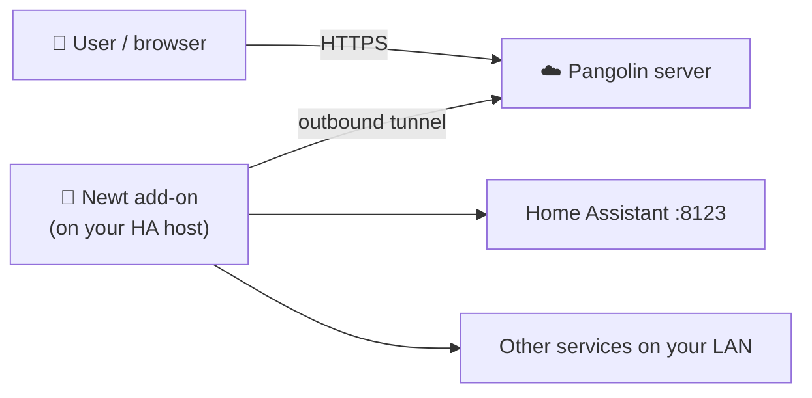

# 🏡 Home Assistant Newt Add-on
[](https://discord.gg/fTHY3ZM8nY)
[](https://github.com/Ferdinand99/home-assistant-newt-addon/commits)

[](https://github.com/Ferdinand99/home-assistant-newt-addon/stargazers)
[](https://github.com/Ferdinand99/home-assistant-newt-addon/network/members)

[](newt/CHANGELOG.md)
[](newt-beta/CHANGELOG.md)


[](https://my.home-assistant.io/redirect/supervisor_add_addon_repository/?repository_url=https%3A%2F%2Fgithub.com%2FFerdinand99%2Fhome-assistant-newt-addon)

> ℹ️ Since Home Assistant 2026.2, add-ons are called **apps**. This README uses the menu names from current versions (**Settings → Apps**). On older versions, the same menu is called **Settings → Add-ons**.

---

## 📌 About this Add-on

This add-on runs **[Newt](https://github.com/fosrl/newt)**, the tunnel client for **[Pangolin](https://docs.fossorial.io/Newt/overview)** by Fossorial, directly on your Home Assistant host.

Newt opens an **outbound** tunnel from your home network to your Pangolin server. Pangolin can then publish Home Assistant and other services on your network under your own domain, **without port forwarding** on your router and without exposing your home IP address.

You configure everything from the Home Assistant UI: the Pangolin endpoint, the Newt ID and secret, and any optional Newt settings.

---

## ⚙️ How it Works



1. When the add-on starts, `run.sh` reads your settings from the add-on configuration and exits with an error if `PANGOLIN_ENDPOINT`, `NEWT_ID` or `NEWT_SECRET` is missing.
2. It exports your settings as environment variables and starts the Newt binary.
3. Newt connects to your Pangolin server and keeps the tunnel open. Pangolin forwards requests for your resources through the tunnel, and Newt delivers them to the targets you've set up in Pangolin.
4. If Newt exits for any reason, the add-on waits 5 seconds and starts it again. Stopping the add-on shuts Newt down cleanly.

The add-on uses **host networking** (`host_network: true`), so Newt sees the same network as the Home Assistant host itself. Targets like `127.0.0.1:8123` or your LAN IP addresses work just like they would from the host.

---

## 🚀 Features

- ✅ Easy installation from the Home Assistant app store, with one repository for both the stable and the beta channel
- ✅ Configure everything from the Home Assistant UI
- ✅ Pass any of [Newt's optional environment variables](https://github.com/fosrl/newt?tab=readme-ov-file#environment-variables) through `custom_env_vars`
- ✅ Supports `amd64`, `aarch64`, `armv7` and `armhf` (armhf uses Newt's ARMv6 build)
- ✅ Automatic reconnect: Newt restarts 5 seconds after it exits
- ✅ Real health reporting: the add-on is **healthy** only while the tunnel to Pangolin is actually up
- ✅ Verified downloads: the Newt binary is fetched from the official [fosrl/newt releases](https://github.com/fosrl/newt/releases) and checked against a pinned SHA256 checksum. The build fails if the checksum doesn't match.
- ✅ Credentials and custom variable values are shown as `[REDACTED]` in the logs
- ✅ Starts automatically when Home Assistant boots
- ✅ Beta channel with a hardened AppArmor profile enabled by default

---

## 🧪 Stable vs. Beta

This repository contains two separate add-ons. Add the repository once, and both show up in the store:

| | **Newt Add-on** (stable) | **Newt Add-on (Beta)** |
|---|---|---|
| Folder | [`newt/`](newt/) | [`newt-beta/`](newt-beta/) |
| New Newt releases | After at least 5 days on beta | Same day or shortly after upstream release |
| AppArmor | Disabled | **Enabled** with a [hardened profile](newt-beta/apparmor.txt) |
| `NEWT_SECRET` in the UI | Plain text field | Masked password field |
| Newt's native WireGuard interface modes | ✅ Supported | ❌ Blocked by AppArmor (default netstack mode only) |
| Store label | — | Experimental |

**Which one should I use?**
- Use **stable** if you want the most tested version, if your host doesn't support AppArmor, or if you use Newt's native interface modes (`USE_NATIVE_INTERFACE`, `USE_NATIVE_MAIN_INTERFACE` or client mode).
- Use **beta** if you want new Newt releases and hardening right away, and can live with the occasional issue.

> ⚠️ Run only one of them at a time with the same Newt ID and secret.

### 📢 How Updates Reach You

The update flow is automated with GitHub Actions:

1. **Beta:** a workflow checks for new [fosrl/newt](https://github.com/fosrl/newt/releases) releases twice a day. When it finds one, it opens a pull request that bumps the Newt version and the pinned SHA256 checksums in `newt-beta/`.
2. **Stable:** once a Newt version has run on beta for at least **5 days**, a second workflow opens a pull request that promotes the same version to `newt/`.
3. Changes beyond the Newt version, such as hardening and new features, are tested on beta first and promoted to stable by hand.

See the changelogs for what changed in each release: [stable](newt/CHANGELOG.md) · [beta](newt-beta/CHANGELOG.md).

---

## 🛠️ Installation

### 1️⃣ Get Your Newt Credentials from Pangolin

In your Pangolin dashboard, create a **site** of type **Newt**. Pangolin shows you the three values you need:

- the **endpoint** (your Pangolin URL, for example `https://pangolin.example.com`)
- the **Newt ID**
- the **Newt secret**

Copy them somewhere safe. You'll enter them in the add-on configuration in step 3.

### 2️⃣ Add the Repository

**The quick way:** click the **Add repository** button at the top of this page. It opens your Home Assistant instance with the repository URL filled in.

**Manually:**
1. Go to **Settings → Apps** and open the store.
2. Open the menu (three dots, top right) and choose **Repositories**.
3. Add one of these URLs:
   ```
   https://github.com/Ferdinand99/home-assistant-newt-addon
   ```
   or the mirror:
   ```
   https://git.opland.net/Ferdinand99/home-assistant-newt-addon
   ```
4. Click **Add** and wait for the repository to load. **Newt Add-on** and **Newt Add-on (Beta)** both appear in the store.

### 3️⃣ Install, Configure and Start

1. Pick **Newt Add-on** (stable) or **Newt Add-on (Beta)** and click **Install**.
2. Open the **Configuration** tab and enter your values for `PANGOLIN_ENDPOINT`, `NEWT_ID` and `NEWT_SECRET`. Add any `custom_env_vars` you need (optional).
3. Click **Save**, then **Start**.
4. Check the **Log** tab. After a successful start, you'll see:
   ```
   🔹 Starting Newt inside Home Assistant OS...
   ✅ Configuration Loaded:
     PANGOLIN_ENDPOINT=[REDACTED]
     NEWT_ID=[REDACTED]
     NEWT_SECRET=[REDACTED]
   ...
   🔹 Starting Newt...
   ```
   Newt's own output follows. Your site should show as online in Pangolin.

---

## 🔧 Configuration

| Option | Required | Description |
|---|---|---|
| `PANGOLIN_ENDPOINT` | ✅ | The URL of your Pangolin server, for example `https://pangolin.example.com` |
| `NEWT_ID` | ✅ | The Newt ID that Pangolin generated for this site |
| `NEWT_SECRET` | ✅ | The Newt secret that Pangolin generated for this site |
| `custom_env_vars` | ❌ | A list of extra environment variables for Newt, one `NAME=value` per entry |

### Custom Environment Variables

Use `custom_env_vars` to set any of Newt's optional settings. See the [Newt documentation](https://github.com/fosrl/newt?tab=readme-ov-file#environment-variables) for the full list.

**Example:**

```yaml
custom_env_vars:
  - "ACCEPT_CLIENTS=true"
  - "LOG_LEVEL=DEBUG"
  - "MTU=1420"
```

**In the Home Assistant UI:**
1. Go to **Settings → Apps → Newt Add-on → Configuration**.
2. Add each variable as its own entry in the **custom_env_vars** list, in the format `VARIABLE_NAME=value`.
3. Click **Save** and restart the add-on.

**Rules:**
- Names must use uppercase letters, digits and underscores, and can't start with a digit. The value can't be empty. Home Assistant won't save an entry that doesn't match `NAME=value`.
- For safety, these variables are **ignored** if you set them here: `PATH`, `HOME`, `LD_*`, `HEALTH_FILE`, `PANGOLIN_ENDPOINT`, `NEWT_ID` and `NEWT_SECRET`. The log shows `⚠️ Skipping protected variable: <NAME>` when that happens. Set the credentials in their own fields instead.
- Values are shown as `[REDACTED]` in the log. Only the variable names are visible.

### Persistent Data

The add-on sets Newt's `HOME` to `/data` and `XDG_CONFIG_HOME` to `/data/.config`. Anything Newt saves there survives restarts and updates, and it's included in Home Assistant backups of the add-on.

---

## 🌐 Exposing Home Assistant through Pangolin

To reach Home Assistant itself through Pangolin, create a **resource** in Pangolin on your Newt site. Point it at Home Assistant, for example `http://127.0.0.1:8123` or `http://<your-ha-ip>:8123`.

Home Assistant blocks proxied requests by default. You also need to tell it to trust the proxy, as described below.

<a id="reverse-proxy-setup"></a>
### 🛡️ Reverse Proxy / `trusted_proxies` Setup

> **Note:** Current versions of Home Assistant configure reverse proxy settings in the UI. The old `http:` block in `configuration.yaml` is imported once on upgrade and **ignored** after that. You'll see the repair issue *"HTTP YAML configuration is ignored after migration"* if it's still there.

#### 📘 Step-by-Step Instructions

1. Go to **Settings → System → Network** and find the **HTTP server** section.
2. Turn on **Trust X-Forwarded-For**.
3. Under **Trusted proxies**, add the address that Newt's requests come from:
   - `127.0.0.1` if your Pangolin resource points at `127.0.0.1` or `localhost`
   - your Home Assistant host's IP (for example `192.168.1.2`) if the resource points at that IP
   - the IP of any other reverse proxy in front of Home Assistant
4. Click **Save**. Home Assistant restarts and asks you to **confirm** the new settings. If you don't confirm within 5 minutes, it reverts to the previous settings.

> 💡 **Not sure which IP to add?** Open your Home Assistant URL through Pangolin, then check **Settings → System → Logs**. Home Assistant logs a message like *"A request from a reverse proxy was received from 127.0.0.1, but your HTTP integration is not set-up for reverse proxies"*. Add the IP from that message.
>
> When you enter a network, use the network address and not a host address: `192.168.1.0/24`, not `192.168.1.50/24`.

Because the add-on uses host networking, it doesn't get an address on the internal add-on network (`172.30.32.0/23`). Its requests come from the host itself, which is why `127.0.0.1` or the host IP is what you need.

If you have an old `http:` block with `use_x_forwarded_for` / `trusted_proxies` in `configuration.yaml`, remove it once the settings show up correctly in the UI.

<details>
<summary>Older Home Assistant versions (no HTTP server section in the UI)</summary>

If your Home Assistant version doesn't have the **HTTP server** section under **Settings → System → Network** yet, add this to `configuration.yaml` instead and restart Home Assistant:

```yaml
http:
  use_x_forwarded_for: true
  trusted_proxies:
    - 127.0.0.1       # Localhost
    - 192.168.1.2     # Example: your Home Assistant host IP
```

</details>

#### ✅ When to Use This

You need this setup if:

- You expose Home Assistant through Pangolin or another reverse proxy (for example NGINX or Traefik).
- You get **400: Bad Request**, token errors or **403: Forbidden** when you open Home Assistant through the proxy.
- The Home Assistant log shows the *"not set-up for reverse proxies"* message above.

---

## 💚 Health Status

The add-on reports **healthy** once Newt has established the tunnel to your Pangolin server, and **unhealthy** if that connection is lost.

Newt manages this signal itself. It writes a health file (`/tmp/healthy`) when its connection check to Pangolin succeeds, and removes it when the connection drops. A Docker health check looks for that file every 30 seconds, after a 60-second start period. So the status reflects real tunnel connectivity, not just whether the process is running.

> This is separate from the per-resource *Target* health checks you may see in the log (`Target NNN: health check failed: ...`). Those come from Pangolin checking your own services behind the tunnel, and they don't affect the add-on's health status.

---

## 🔒 Security

- **No Home Assistant API access:** the add-on doesn't request access to the Supervisor, Home Assistant or auth APIs.
- **Limited privileges:** the add-on only requests the `NET_ADMIN` and `NET_RAW` capabilities that Newt needs for networking.
- **Verified binary:** the Newt binary is pinned to an exact version and checked against a SHA256 checksum at build time.
- **No secrets in logs:** the endpoint, ID, secret and all custom variable values are shown as `[REDACTED]`.
- **Protected variables:** `custom_env_vars` can't override `PATH`, `HOME`, `LD_*`, the health file or your credentials.
- **AppArmor (beta):** the beta channel ships an [AppArmor profile](newt-beta/apparmor.txt) that denies mounts, kernel module loading, ptrace, `SYS_ADMIN`, and writes to `/proc` and `/sys`.

---

## 🔍 Troubleshooting

💡 **The add-on doesn't start**
- Check the log (**Settings → Apps → Newt Add-on → Log**).
- `❌ ERROR: Missing required configuration values!` means `PANGOLIN_ENDPOINT`, `NEWT_ID` or `NEWT_SECRET` is empty. Fill in all three and save.

💡 **The log keeps showing `Newt stopped with exit code ...! Waiting 5 seconds before reconnecting...`**
- Newt starts but keeps exiting. Check the Newt output just above that line for the reason.
- Check that the endpoint, ID and secret match your Pangolin site exactly. If the site was deleted or recreated in Pangolin, the old ID and secret no longer work.
- Check that your Home Assistant host can reach your Pangolin server.

💡 **The add-on shows as unhealthy**
- The tunnel to Pangolin isn't up right now. See the point above, and check the site status in Pangolin.

💡 **Home Assistant shows 400: Bad Request through Pangolin**
- Follow the [reverse proxy setup](#reverse-proxy-setup) above.

💡 **A custom environment variable has no effect**
- Look for `⚠️ Skipping protected variable` in the log. That variable can't be set through `custom_env_vars`.
- Check the variable name against the [Newt documentation](https://github.com/fosrl/newt?tab=readme-ov-file#environment-variables).
- Restart the add-on after saving.

💡 **Native interface mode doesn't work on beta**
- The beta channel's AppArmor profile only supports Newt's default netstack mode. Use the stable channel for `USE_NATIVE_INTERFACE`, `USE_NATIVE_MAIN_INTERFACE` or client mode.

Still stuck? Ask on [Discord](https://discord.gg/fTHY3ZM8nY) or open a [GitHub issue](https://github.com/Ferdinand99/home-assistant-newt-addon/issues). Include your add-on version and the relevant log lines.

---

## 📁 Repository Layout

```
.
├── repository.json        # Add-on repository manifest
├── newt/                  # Stable add-on
│   ├── config.yaml        # Add-on manifest (options, schema, permissions)
│   ├── Dockerfile         # Downloads and verifies the Newt binary
│   ├── run.sh             # Entrypoint: reads config, starts Newt, reconnects
│   ├── DOCS.md            # Shown in the add-on's Documentation tab
│   └── CHANGELOG.md
├── newt-beta/             # Beta add-on (same layout)
│   └── apparmor.txt       # AppArmor profile, beta only
└── .github/workflows/     # Version bumps, stable promotion, validation, mirror
```

---

## 🤝 Contributing

Want to help improve this project? See [CONTRIBUTING.md](CONTRIBUTING.md) to get started.
You can report issues on [GitHub](https://github.com/Ferdinand99/home-assistant-newt-addon/issues) or in our [Discord community](https://discord.gg/fTHY3ZM8nY).

---

## 🔗 Useful Links

- 📖 [Newt documentation](https://docs.fossorial.io/Newt/overview)
- 🐙 [Newt on GitHub](https://github.com/fosrl/newt) · [Newt releases](https://github.com/fosrl/newt/releases)
- 🏡 [Home Assistant](https://www.home-assistant.io/)
- 🔀 [Home Assistant HTTP / reverse proxy settings](https://www.home-assistant.io/integrations/http/)

---

Made with ❤️ for Home Assistant users 🚀
